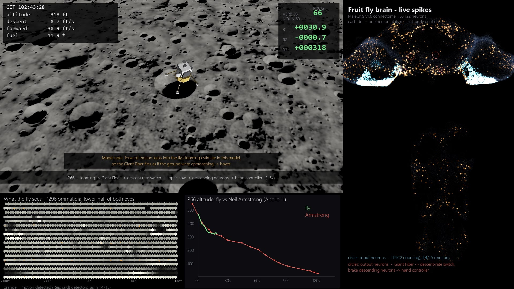
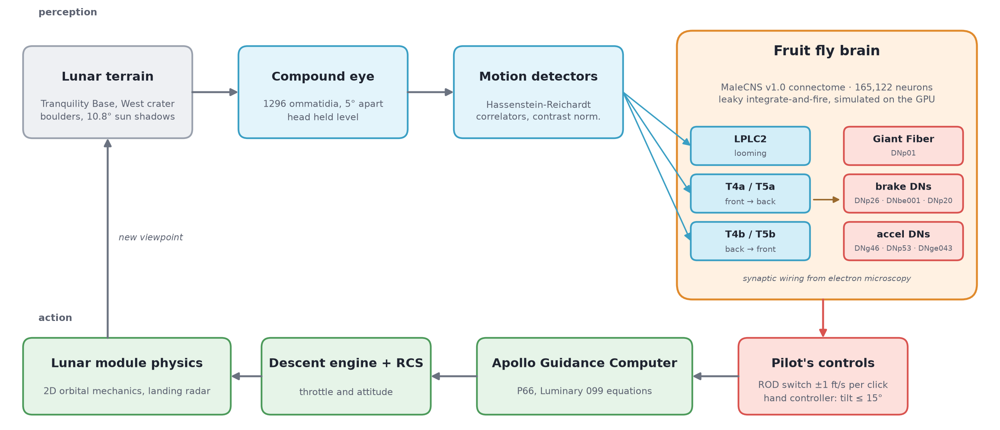
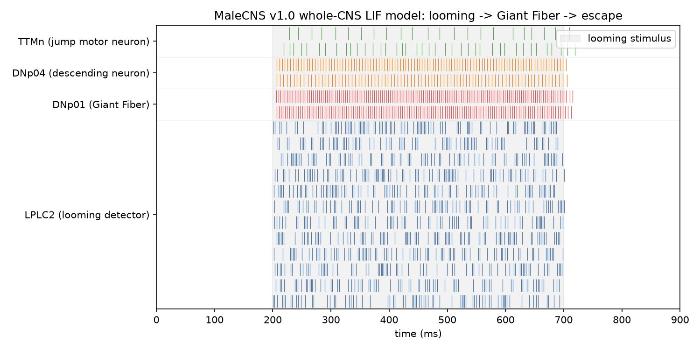
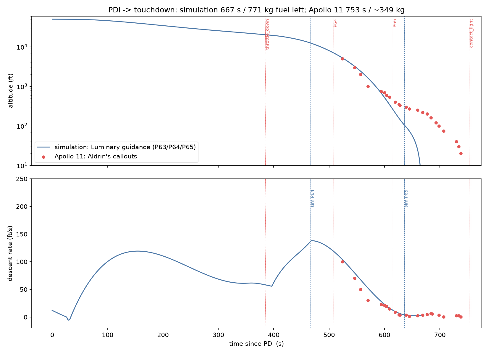
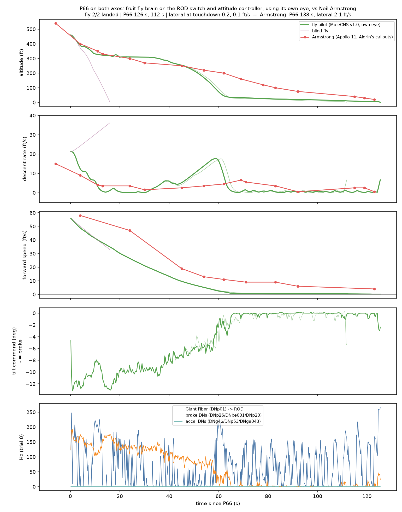
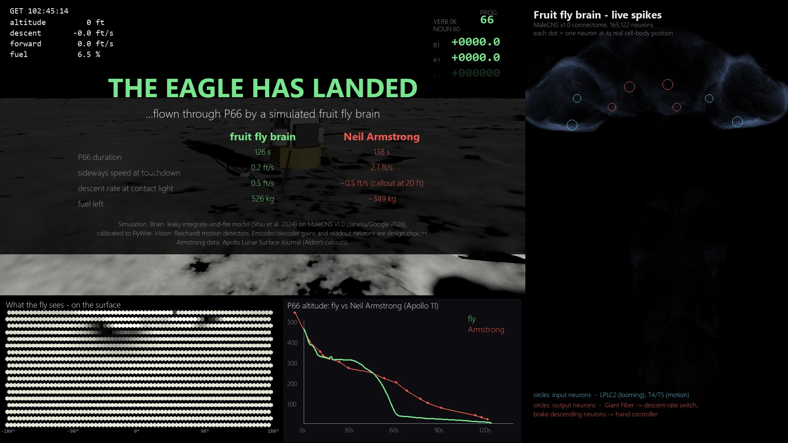

# Can a Fruit Fly Brain Land Apollo 11?

A simulated *Drosophila* brain, wired from the complete male fly connectome (165,122 neurons), takes over
the Apollo 11 lunar module at the same moment Neil Armstrong did and flies the last 470 ft to the surface
of the Moon. It works the same two controls Armstrong had in P66: the rate-of-descent switch and the attitude
hand controller. It decides how to use them from what its own compound eye sees.



The video, 1:52 long, is rendered by `experiments/make_video.py`.

Apart from the published data, everything here was built for this project:
- the GPU port of the brain model
- the connectome calibration
- the compound-eye model
- the lunar descent simulator with its guidance computer, terrain and 3D renderer
- the video

---

## How it works



**Brain.** This is a PyTorch/CUDA port of the leaky integrate-and-fire model of
[Shiu et al. (2024)](https://doi.org/10.1038/s41586-024-07763-9), with the same equations and parameters. It runs on the
[MaleCNS v1.0](https://www.janelia.org/project-team/flyem/male-cns-connectome) connectome: 165,122 traced
neurons covering the brain, optic lobes and nerve cord. Event-driven spike propagation captured in CUDA
graphs runs about 11× faster than a sparse mat-vec per step, at roughly 2.6 s of wall time per simulated
second on an RTX 4060 Laptop GPU.

**Making the model behave on a new connectome.** With the raw MaleCNS weights, any stimulus pushed the
model into a persistent state of ~20,000 active neurons, with every Kenyon cell on. The fix in
`scripts/calibrate_connectome.py` uses data or published biology at each step instead of free tuning:

1. **Per-type rescaling to FlyWire.** Shiu's 0.275 mV/synapse was tuned on FlyWire synapse counts. Across
   7,223 matched cell types, MaleCNS counts a median of 1.80× more input synapses per neuron (IQR 1.43–2.38).
   Each neuron's inputs are divided by its own type's ratio. FlyWire is a female brain and MaleCNS a male
   one, so a small part of this ratio may reflect real sex differences. The MaleCNS paper finds that the
   large majority of cell types are shared between the sexes.
2. **Neuromodulators are not fast synapses.** Dopamine, serotonin and octopamine act through slow
   metabotropic receptors. The original model treated them as excitatory, and they supplied ~29 % of the
   excitatory current in the runaway state. Their 903 neurons and 1.8 M synapses are removed from the fast network.
3. **Conductance-based synapses.** Reversal potentials are E_exc = 0 mV and E_inh = −75 mV.

| LPLC2 stimulus, 300 ms | active neurons during | active 500 ms after | Kenyon cells active |
|---|---|---|---|
| raw weights + original model | 20,799 | 16,783 | 100 % |
| calibrated + conductance | 1,356 | 0 | 0 % |

Odour stimuli now activate about 3 % of Kenyon cells, close to the sparse 5–10 % reported in vivo. The
looming → Giant Fiber → jump motor neuron pathway and the sugar → MN9 proboscis pathway still work.



**Eye.** Rays are cast from the LM into the terrain on a 5° grid, giving 1296 ommatidia over the lower half
of both eyes. Each ommatidium is band-limited to its own footprint. Photoreceptors are modelled as
high-pass filters, followed by Hassenstein–Reichardt correlators with contrast normalisation. The eye
produces three signals:

| eye signal | input neurons |
|---|---|
| expansion (looming) | LPLC2 |
| front-to-back flow | T4a/T5a |
| back-to-front flow | T4b/T5b |

The head is held level, as flies do with neck reflexes. A first version tilted the eye with the LM, and
forward motion then looked like an approaching ground.

**Readout.**
- **Vertical:** Giant Fiber rate above 100 Hz clicks ROD up (slower descent). Below 40 Hz, ROD clicks down,
  at most once per second.
- **Horizontal:** descending neurons were picked by measuring direction selectivity inside the model.
  - Brake: DNp26, DNbe001, DNp20 respond to front-to-back flow.
  - Accelerate: DNg46, DNp53, DNge043 respond to back-to-front flow.
  - Their rate difference sets a proportional tilt of up to 15°.

The gains, thresholds and choice of readout neurons are design decisions, documented in
`lander/visual_pilot.py`.

**Apollo side.** `apollo_sim/` is a 2D lunar descent simulator written from scratch for this project; no
existing flight simulator is used. Its guidance follows the Luminary 099
source of the Apollo 11 LM computer:
- **Guidance:** the TTF cubic, the QUADGUID acceleration command, AFCCALC thrust limiting, the
  P63 → P64 → P65 switch criteria, the P66 ROD loop and the throttle logic around the fixed throttle position.
- **Targets:** from the Apollo 10 (Luminary 069) pad load.
- **Terrain:** a Tranquility Base-like map with West crater (190 m) and Little West, a power-law crater
  population, 900 boulders and shadows from a 10.8° sun. The physics, landing radar, eye and 3D view all
  share this map.

With the computer flying alone, the numbers line up with the real descent:

| event | simulation | Apollo 11 |
|---|---|---|
| throttle-down | PDI + ~400 s | PDI + 385 s |
| P66 at ~470 ft | PDI + 602 s | PDI + 615 s |
| forward speed at P66 | 17.1 m/s | 17.7 m/s ("58 forward") |



## Results

The fly takes over at 461 ft, P66, at PDI + 602 s. Five runs start from the same state:

| run | outcome | P66 time | lateral at touchdown | sink rate at contact light | fuel left |
|---|---|---|---|---|---|
| fly, trial 0 | landed | 126 s | 0.2 ft/s | 0.49 ft/s | 526 kg |
| fly, trial 1 | landed | 112 s | 0.1 ft/s | 0.38 ft/s | 582 kg |
| blind fly (same brain, no visual input) | crashed at 36 ft/s | — | — | — | — |
| P66, nobody on the controls | crashed into the wall of Little West (26° slope) | — | — | — | — |
| automatic P65 (no fly) | landed | 65 s | 0.0 ft/s | 3.3 ft/s | 773 kg |
| **Neil Armstrong** | **landed** | **138 s** | **2.1 ft/s** | **~0.5 ft/s** | **~349 kg** |



Both fly trials set down on 2° ground about 140 m past the target, roughly 690 m west of West crater.
Armstrong also flew past West and landed about 550 m beyond it. He was steering away from a boulder
field, though, while the fly has no landing target and simply drifted there while braking slowly.



## Limitations

- **Simulation only.** No real fly was involved. The brain is a point-neuron LIF model built from a
  connectome, with no dendrites, gap junctions, neuromodulation or plasticity.
- **Calibration choices.** Per-type rescaling, removing neuromodulators from the fast network and using
  conductance-based synapses are this project's choices. Their reasoning is in
  `scripts/calibrate_connectome.py`.
- **Antennal lobe loop.** Excitatory local neurons in the antennal lobe (lLN1_bc, lLN2T) form a loop with
  projection neurons that keeps firing after an odour ends. In flies this coupling is largely through gap
  junctions, which electron microscopy does not capture, so it is left as is. The pilot does not use the
  olfactory pathway.
- **Design choices in the pilot.** Encoder and decoder gains, thresholds, readout neurons and the Reichardt
  front end were chosen by the author.
- **The hover and the fast drop are artefacts.** Between P66 + 10 s and 32 s the LM almost hovers at
  ~310 ft. Then, between 42 s and 58 s, it drops at up to 17 ft/s. Logged data show both come from channel
  mixing in the eye model, not from a deliberate behaviour:
  - During the hover, forward flow leaks into the expansion signal and the Giant Fiber fires as if the
    ground were approaching.
  - Once forward speed drops, the real approach is under-read.

  Real LPLC2 neurons avoid this with radial motion opponency (Klapoetke et al. 2017). The video labels
  both segments.
- **Simplified Apollo side.**
  - Physics is 2D, with no lateral axis.
  - Navigation is perfect: no 2900 ft altitude error and no 1202 alarms.
  - The guidance frame is fixed and LEADTIME is not modelled.
  - The AGC is a re-implementation of the Luminary equations, not an emulator. The approach-phase jerk
    targets are solved for consistency with the pad load, because their AGC scaling could not be converted
    reliably. The result agrees with NASSP's Apollo 12 value.
- **Touchdown speed.** The touchdown speed (~7 ft/s) is set by procedure: the engine stops 1 s after contact
  light, followed by ~1.5 m of free fall. The sink rate at contact light is the number that reflects the fly.

## Running it

Requirements: Python 3.12, an NVIDIA GPU with CUDA (8 GB is enough), and about 3 GB of disk for the data.

```bash
python -m venv .venv
.venv/Scripts/activate            # Windows; source .venv/bin/activate elsewhere
pip install torch==2.11.0 --index-url https://download.pytorch.org/whl/cu128
pip install -r requirements.txt
```

**Data.** Download these files into the folders shown:

| folder | files | source |
|---|---|---|
| `data/malecns_v1.0/` | `body-annotations-male-cns-v1.0-minconf-0.5.feather`, `body-neurotransmitters-male-cns-v1.0.feather`, `connectome-weights-male-cns-v1.0-minconf-0.5.feather` | `https://storage.googleapis.com/flyem-male-cns/v1.0/connectome-data/flat-connectome/` |
| `data/flywire_783/` | `Connectivity_783.parquet`, `Completeness_783.csv` | [philshiu/Drosophila_brain_model](https://github.com/philshiu/Drosophila_brain_model) |
| `data/flywire_783/` | `neuron_annotations.tsv` | [flyconnectome/flywire_annotations](https://github.com/flyconnectome/flywire_annotations) |
| `external/` (optional) | Apollo source code, read-only reference | [chrislgarry/Apollo-11](https://github.com/chrislgarry/Apollo-11), [virtualagc/virtualagc](https://github.com/virtualagc/virtualagc) |

The `external/` sources are not needed to run anything.

**Pipeline.**

```bash
python scripts/prepare_connectome.py          # signed weights, neuron table, soma positions
python scripts/calibrate_connectome.py        # calibrated weights
python experiments/validate_kc_fix.py         # raw vs calibrated model
python experiments/phase3c_terrain_fly.py     # main experiment (~40 min), results/phase3c
python experiments/plot_phase3b.py phase3c    # figure
python experiments/make_video.py              # video (~6 min), results/video
```

**Flying it yourself.**

```bash
python -m apollo_sim.viewer3d --p66
```

Controls:
- `=` / `-`: ROD
- arrow keys: hand controller
- `C`: camera
- `E`: fly's eye

Earlier stages are kept as separate scripts:
- `validate_phase1.py`: circuit checks.
- `land_phase2.py`: toy vertical-only lander.
- `phase3_fly_p66.py`: Apollo descent with an analytic looming input.
- `phase3b_visual_fly.py`: first two-axis visual pilot over flat ground.

## Layout

```
flybrain/     connectome loader, LIF model (reference and CUDA-graph versions)
apollo_sim/   constants, LM physics, AGC guidance, terrain, fly eye, renderers, viewers, Apollo 11 reference data
lander/       fly pilots (analytic looming pilot, visual two-axis pilot) and the toy P66 model
scripts/      data preparation and connectome calibration
experiments/  experiments, plots and the video renderer
docs/img/     figures used in this README
```

## Licence

- **Code:** MIT.
- **Figures and video:** the figures in `docs/img/` and the rendered video are
  [CC BY 4.0](https://creativecommons.org/licenses/by/4.0/). Reuse is welcome with credit and a link to this
  repository.

See [LICENSE](LICENSE).

## Data sources and their licences

- **MaleCNS v1.0** connectome: Janelia FlyEM, Cambridge Connectomics and Google Research, CC-BY 4.0.
- **FlyWire 783** connectivity and annotations: as distributed by the Shiu model and FlyWire annotation
  repositories, under their licences.
- **Apollo 11 source code:** public domain, via Virtual AGC.
- **Landing callouts and event times:** Apollo Lunar Surface Journal.

## References

**Connectome and brain model**
- Shiu, P. K. et al. A *Drosophila* computational brain model reveals sensorimotor processing. *Nature* 634, 210–219 (2024).
- Janelia FlyEM, Cambridge Connectomics & Google Research. Sexual dimorphism in the complete *Drosophila* male central nervous system connectome. *Cell* 189, 5504–5526 (2026). doi:10.1016/j.cell.2026.08.015
- Dorkenwald, S. et al. Neuronal wiring diagram of an adult brain. *Nature* 634, 124–138 (2024).
- Schlegel, P. et al. Whole-brain annotation and multi-connectome cell typing of *Drosophila*. *Nature* 634, 139–152 (2024).

**Looming, escape and motion vision**
- von Reyn, C. R. et al. A spike-timing mechanism for action selection. *Nature Neuroscience* 17, 962–970 (2014).
- Ache, J. M. et al. Neural basis for looming size and velocity encoding in the *Drosophila* giant fiber escape pathway. *Current Biology* 29, 1073–1081 (2019).
- Klapoetke, N. C. et al. Ultra-selective looming detection from radial motion opponency. *Nature* 551, 237–241 (2017).
- Maisak, M. S. et al. A directional tuning map of *Drosophila* elementary motion detectors. *Nature* 500, 212–216 (2013).
- Hassenstein, B. & Reichardt, W. Systemtheoretische Analyse der Zeit-, Reihenfolgen- und Vorzeichenauswertung bei der Bewegungsperzeption des Rüsselkäfers *Chlorophanus*. *Z. Naturforsch.* 11b, 513–524 (1956).
- Srinivasan, M. V. et al. How honeybees make grazing landings on flat surfaces. *Biological Cybernetics* 83, 171–183 (2000).

**Olfaction and the mushroom body (model checks)**
- Turner, G. C., Bazhenov, M. & Laurent, G. Olfactory representations by *Drosophila* mushroom body neurons. *J. Neurophysiol.* 99, 734–746 (2008).
- Honegger, K. S., Campbell, R. A. A. & Turner, G. C. Cellular-resolution population imaging reveals robust sparse coding in the *Drosophila* mushroom body. *J. Neurosci.* 31, 11772–11785 (2011).
- Shang, Y. et al. Excitatory local circuits and their implications for olfactory processing in the fly antennal lobe. *Cell* 128, 601–612 (2007).

**Apollo and the Moon**
- Klumpp, A. R. Apollo lunar descent guidance. *Automatica* 10, 133–146 (1974).
- NASA. Apollo 11 Mission Report, MSC-00171 (1969).
- Jones, E. M. & Glover, K. (eds.) Apollo Lunar Surface Journal, "The First Lunar Landing". https://apollojournals.org/alsj/a11/a11.landing.html
- Burkey, R. et al. Virtual AGC project. https://github.com/virtualagc/virtualagc
- Pike, R. J. Size-dependence in the shape of fresh impact craters on the moon. In *Impact and Explosion Cratering*, 489–509 (Pergamon, 1977).
